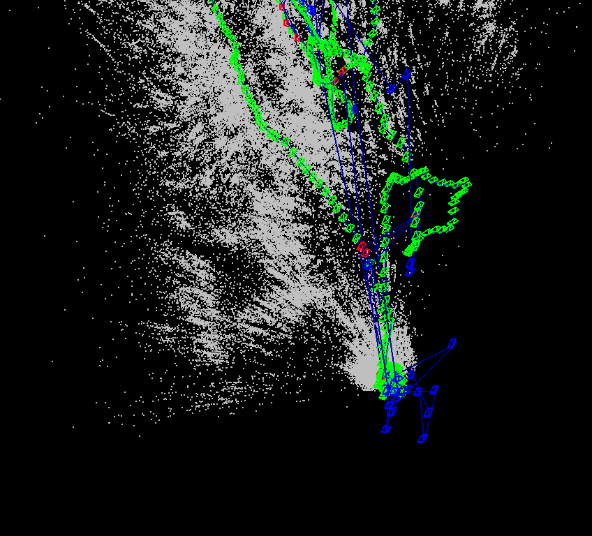

# MC-SLAM: Multi-Camera SLAM

Feature-based SLAM for multi-camera rigs (stereo and larger arrays), with optional IMU fusion,
DBoW2 loop closure and global relocalization. The back end is a GTSAM factor graph (iSAM2) with
multi-camera smart projection factors.

MC-SLAM was developed at the [NEU Field Robotics Lab](https://github.com/neufieldrobotics)
(original author: Pushyami Kaveti). This repository is my (Anush Sriram Ramesh's) refurbished
fork: I wrote the global relocalization, the fast tracking front end, and the pose-only factor-graph
back end that serves it, and I have ported the system to GTSAM 4.3 and benchmarked and debugged it
on EuRoC.

<p align="center"></p>
<p align="center"><sub>EuRoC MH_01, stereo only: keyframe trajectory (green), landmarks (grey),
loop-closure candidates (blue).</sub></p>

## Results on EuRoC MAV

All 11 sequences, full length, `--deterministic`, evaluated with
[evo](https://github.com/MichaelGrupp/evo) against the body-frame ground truth (SE(3)
alignment, no scale correction). ATE is the RMSE of the absolute trajectory error over keyframes.
Machine: 24-core desktop, single SLAM thread.

| Sequence | Stereo ATE | Stereo + IMU ATE | Stereo rot. error | Stereo + IMU rot. error |
|---|---|---|---|---|
| MH_01_easy | 4.0 cm | 3.7 cm | 1.1° | 1.4° |
| MH_02_easy | **2.7 cm** | 18.8 cm | 0.6° | 2.9° |
| MH_03_medium | **3.2 cm** | 22.8 cm | 1.2° | 1.3° |
| MH_04_difficult | **17.6 cm** | 82.5 cm | 1.4° | 3.8° |
| MH_05_difficult | **18.4 cm** | 36.8 cm | 1.3° | 1.9° |
| V1_01_easy | 17.2 cm | **3.6 cm** | 6.1° | 5.5° |
| V1_02_medium | 14.2 cm | **3.2 cm** | 3.0° | 2.1° |
| V1_03_difficult | 35.2 cm | **11.1 cm** | 10.4° | 4.0° |
| V2_01_easy | 5.0 cm | 4.9 cm | 1.2° | 1.0° |
| V2_02_medium | **14.1 cm** | 41.5 cm | 2.2° | 5.3° |
| V2_03_difficult | 179 cm | **84 cm** | 32.0° | 4.4° |

Stereo only runs at 52-114 ms per frame. The IMU helps most on the fast, rotation-heavy Vicon-room
sequences. On the machine-hall sequences it is still less accurate than stereo alone, because
the stereo+IMU graph triggers many failed incremental iSAM2 updates (see Known issues).

### What changed against the original code

At the start of this work, 9 of the 11 sequences crashed. Stereo-only MH_01 had 4.6 cm ATE and
took 243 ms and 20 GB of RAM. It now runs at 71 ms with 4.7 GB. The main fixes, each in its own commit:

- **Back end:**
  - Smart factors referenced keyframes missing from the graph after an iSAM2 reset.
  - The reset re-anchored the graph at the first keyframe.
  - Loop closures sent the wrong landmark-measurement pairs (an index bug).
  - Smart-factor noise was hard-coded to 15 px with no outlier handling. It is now 1 px with GTSAM's
    degeneracy guards.
  - iSAM2 cached linear factors that go stale with smart factors, and new measurements mutated
    factors that iSAM2 already holds. A failed incremental update is now re-solved in batch
    instead of discarding the map.
- **Front end:**
  - The local-map search matched 65k-126k descriptors on every frame, although only new keyframes
    need them. Tracking is 48% faster.
  - A heap overflow in re-initialization (found with AddressSanitizer).
  - Stereo-only tracking restarted at the origin after a tracking loss. It now restarts at the last
    tracked pose.
  - The keyframe rotation threshold was configured in the wrong unit.
- **Stereo + IMU:**
  - Initialization assumed a static start and a z-up IMU (EuRoC has neither).
  - It is replaced by a stereo-inertial alignment that bootstraps from stereo odometry (gyro bias,
    velocities and gravity from about 2 s of keyframes; unit tested and checked against EuRoC
    ground truth).
  - A 1e-16 IMU integration variance made the graph numerically singular.
- **Tooling:**
  - Deterministic RANSAC seeding, so runs are bit-reproducible.
  - EuRoC reader, headless benchmark mode, per-frame timing CSV, evaluation scripts.
  - About 3,800 lines of dead front-end code removed.
  - The map viewer works again.

## Building

Tested on Ubuntu 24.04 with GCC 11 and CMake 3.28.

| Dependency | Version used |
|---|---|
| GTSAM (+ gtsam_unstable) | 4.3.0 |
| OpenCV | 4.6 (apt) |
| Eigen | 3.4 (apt) |
| Boost | 1.83 (program_options, filesystem, serialization, json) |
| OpenGV, DBoW2, DLib, DLoopDetector, fbow | master |
| Pangolin (viewer, optional) | 0.9 |
| glog, gflags, GeographicLib, GTest | apt |

Build the source dependencies into a prefix (for example `~/opt/<name>`). Then:

```bash
cmake -S . -B build -G Ninja -DCMAKE_BUILD_TYPE=Release \
      -DCMAKE_PREFIX_PATH="$HOME/opt/gtsam-4.3;$HOME/opt/opengv;$HOME/opt/DBoW2;$HOME/opt/DLib;$HOME/opt/DLoopDetector;$HOME/opt/fbow;$HOME/opt/Pangolin"
cmake --build build
(cd build && ctest)            # 19 unit tests
```

Options: `-DMCSLAM_WITH_VIEWER=OFF` builds without Pangolin; `-DMCSLAM_BUILD_TESTS=OFF` skips the tests.

## Running on EuRoC

The scripts expect sequences in ASL format under `~/datasets/euroc/<SEQ>/mav0` with a
`gt_tum.txt` ground truth (`scripts/euroc_gt_to_tum.py`), and the ORB vocabularies
(`ORBvoc.txt`, `orb_mur.fbow`) in `~/datasets/vocab`.

```bash
# stereo only, headless: trajectory, timing CSV and evo APE/RPE in results/mh01
scripts/run_euroc.sh MH_01_easy results/mh01 --deterministic

# stereo + IMU, with the 3D map viewer
IMU=1 VIEWER=1 scripts/run_euroc.sh V1_01_easy results/v101
```

Environment knobs of `run_euroc.sh`:

| Knob | Meaning |
|---|---|
| `IMU` | 0 = stereo only, 1 = stereo + IMU |
| `VIEWER` | 1 = show the Pangolin viewer |
| `KF_ROT_DEG` | keyframe rotation threshold |
| `RANSAC_PX` | tracking RANSAC threshold |
| `BACKEND_PARAMS` | alternative back-end YAML |

Parameters live in `params/euroc/`.

## Layout

| Path | Contents |
|---|---|
| `MCSlam/` | front end (tracking, mapping), back end (iSAM2, smart factors, IMU), loop closure, relocalization, stereo-inertial alignment, viewer |
| `MCDataUtils/` | dataset readers (EuRoC, multi-camera image folders), Kalibr calibration loading |
| `MCApps/` | `mcslam_app` and `vi_align_check`, a tool that checks the stereo-inertial alignment against EuRoC ground truth |
| `tests/` | GTest unit tests (triangulation, factors, vocabulary, EuRoC reader, stereo-inertial alignment) |
| `scripts/` | EuRoC run and evaluation scripts |

## Known issues

- With the IMU, iSAM2 rejects many incremental updates (6-92 per sequence) as indeterminate,
  mostly near velocity variables. The full problem is well conditioned at the moment of failure
  (`MCSLAM_DEBUG_ILS=1` logs the smallest Hessian eigenvalues). The update is recovered by
  re-solving in batch, but this costs accuracy and time on the machine-hall sequences.
- V2_03 (fast motion, motion blur) still loses visual tracking repeatedly.

## License and citation

MIT License, copyright (c) 2022 NEU Field Robotics Lab (see [LICENSE](LICENSE)). If you use
MC-SLAM, please cite the original authors' work.
