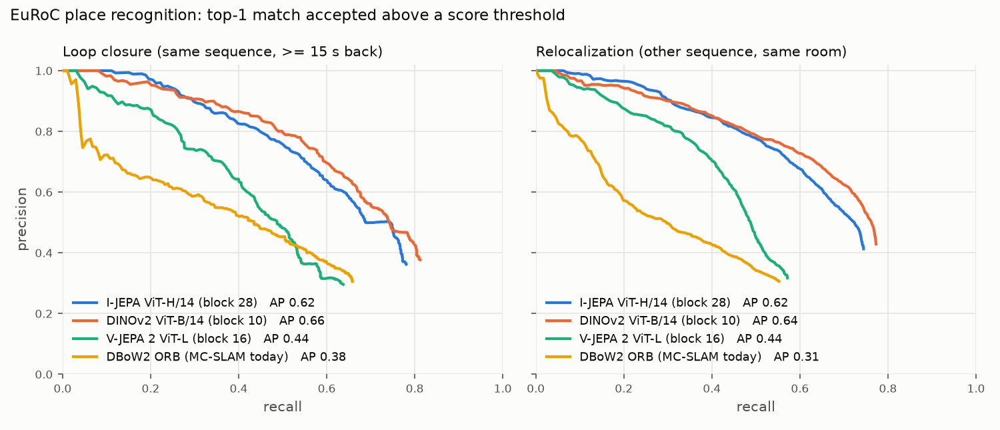

# JEPA representations for place recognition (vs. DBoW2)

Question: can a self-supervised JEPA image encoder replace VIO-SLAM's DBoW2 bag of words as the
place-recognition front end for loop closure and relocalization?

<p align="center"></p>

## Benchmark

- **Frames:** all 11 EuRoC MAV sequences, cam0 sampled at 2 Hz. That gives 2,698 frames, built by
  `prset.py`, independent of the SLAM tracker.
- **Same place:** camera centres within 1.5 m and optical axes within 30°, from ground truth. Every
  environment (machine hall, Vicon room 1, Vicon room 2) has one ground-truth frame shared by all
  its sequences.
- **Loop closure:** each frame queries the frames of the same sequence at least 15 s earlier.
  That is 2,368 queries, of which 1,098 have a true revisit.
- **Relocalization:** each frame queries every *other* sequence of the same environment, for
  example MH_04 against MH_01. That is 8,094 queries, of which 4,482 have a true match. This is
  the setting of VIO-SLAM's global relocalization.
- **Metrics:**
  - R@1: the top-1 match is correct, over queries that have a true match.
  - AP: area under the precision-recall curve of accepting the top-1 match above a score
    threshold. An accepted match for a query without a true match is a false positive, as in SLAM.
  - R@P100: recall at 100% precision.
- **DBoW2:** the loop closer's own ORB extractor settings and `ORBvoc.txt` (`bow_vectors`), with
  the standard L1 score.
- **Learned models:**
  - Input: the grey image replicated to RGB and resized to 224 px height at the native aspect ratio.
  - Descriptor: the mean of the patch tokens of one transformer block, L2-normalised.
  - Comparison: every model at its best block, from a sweep.

## Results

| Method | Loop AP | Loop R@1 | Reloc AP | Reloc R@1 | Reloc AP, Vicon room 2 |
|---|---|---|---|---|---|
| DBoW2 ORB (VIO-SLAM today) | 0.378 | 0.658 | 0.308 | 0.553 | 0.225 |
| V-JEPA 2 ViT-L, block 16 of 24 | 0.442 | 0.638 | 0.438 | 0.572 | 0.268 |
| I-JEPA ViT-g/16 (IN-22k), block 34 of 40 | 0.618 | | 0.616 | | 0.560 |
| I-JEPA ViT-H/14 (IN-22k), block 26 of 32 | 0.609 | | 0.609 | | 0.559 |
| **I-JEPA ViT-H/14 (IN-1k), block 28 of 32** | **0.625** | 0.781 | **0.615** | 0.745 | 0.566 |
| DINOv2 ViT-B/14, block 10 of 12 (reference) | 0.655 | 0.812 | 0.641 | 0.773 | 0.639 |

Descriptors from the model output (last layer, the obvious default) are clearly worse for every JEPA model. Loop AP at
the last layer:

| Model | Last layer | Best block |
|---|---|---|
| I-JEPA ViT-H/14 1k | 0.493 | 0.625 |
| I-JEPA ViT-H/14 22k | 0.385 | 0.609 |
| I-JEPA ViT-g/16 22k | 0.390 | 0.618 |
| V-JEPA 2 ViT-L | 0.284 | 0.442 |

## Findings

1. **I-JEPA features beat DBoW2 by a wide margin.** Loop-closure AP is 65% higher (0.63 vs. 0.38)
   and relocalization AP doubles (0.62 vs. 0.31). The gap is largest across sessions with
   lighting changes and motion blur (Vicon room 2: 0.57 vs. 0.23).
2. **Read I-JEPA at about 85% depth, not at the output.** The best block is consistently at 81-88%
   of the depth (28/32, 26/32, 34/40). I-JEPA is trained to *predict* masked-region features, so
   its last blocks specialise for that target; the most place-discriminative features sit just
   before them. Taking the right block closes most of the gap to DINOv2: 0.63 vs. 0.66 loop AP.
3. **Bigger or more data does not help here.** ViT-g/16 on ImageNet-22k is no better than
   ViT-H/14 on ImageNet-1k.
4. **V-JEPA 2 (video) is the weakest learned model** when fed single frames (as a 2-frame clip).
5. **No single-frame score is safe to accept blindly.** Recall at 100% precision stays at about
   0.1 or below for every method. A SLAM system still needs geometric verification and temporal
   consistency on top. The learned descriptor's job is to put the true place in the candidate list
   (R@5: I-JEPA 0.87, DINOv2 0.91, DBoW2 0.82 loop / 0.72 reloc).

## Reproduce

```bash
python3 -m venv ~/.local/share/jepa-venv
~/.local/share/jepa-venv/bin/pip install torch torchvision --index-url https://download.pytorch.org/whl/cu128
~/.local/share/jepa-venv/bin/pip install transformers pillow numpy scipy scikit-learn matplotlib pyyaml
P=~/.local/share/jepa-venv/bin/python
$P prset.py --out ~/datasets/euroc_prset
$P embed.py --set ~/datasets/euroc_prset --out ~/datasets/euroc_pr_emb --model ijepa_h14_1k --layers 28
$P embed.py --set ~/datasets/euroc_prset --out ~/datasets/euroc_pr_emb --model dinov2_b --layers 10
# DBoW2 vectors: build/bin/bow_vectors ORBvoc.txt <image list> <out>, split per sequence (see embed dir)
$P evaluate.py --set ~/datasets/euroc_prset --emb ~/datasets/euroc_pr_emb dbow2 ijepa_h14_1k:mean_L28 dinov2_b:mean_L10
```

## Next

Feed the I-JEPA candidates into VIO-SLAM's `LoopCloser`, keeping its geometric verification, and
measure the effect on trajectory error and on relocalization success.
